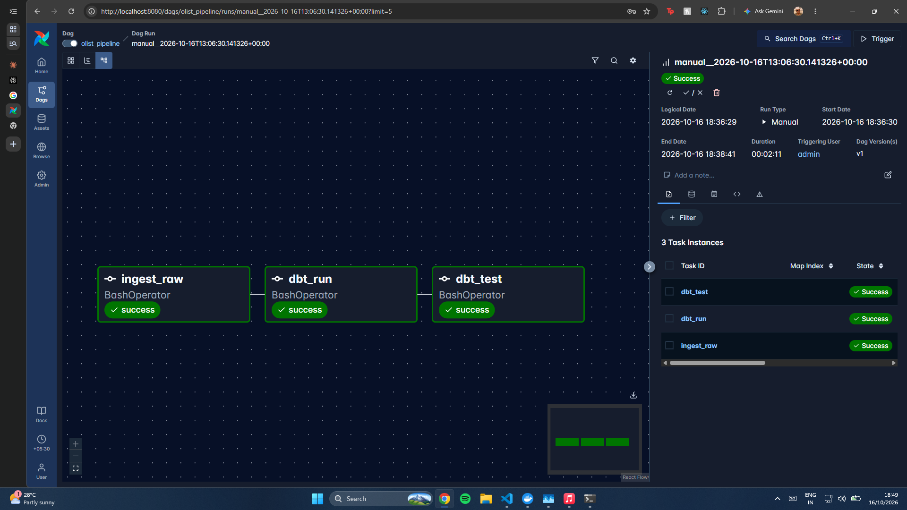

# Olist E-commerce Data Pipeline

An end-to-end data engineering pipeline built on the [Olist Brazilian E-commerce dataset](https://www.kaggle.com/datasets/olistbr/brazilian-ecommerce) (9 CSVs, ~100k orders). Raw files are loaded into PostgreSQL, modeled into a star schema with dbt, tested, and orchestrated daily with Airflow. Everything runs locally via Docker Compose.



## Architecture

```
Olist CSVs (9 files)
      │
      ▼
 ingest.py  (pandas + SQLAlchemy, chunked load)
      │
      ▼
 PostgreSQL  ── raw schema (9 tables, as-is)
      │
      ▼
 dbt staging  ── 8 stg_ models (cleaning, typing, renaming)
      │
      ▼
 dbt marts    ── star schema
      │          fact_orders
      │          dim_customers · dim_products · dim_sellers · dim_dates
      ▼
 dbt tests    ── not_null, unique, accepted values, relationships (21 tests)

 Orchestrated by Airflow:  ingest_raw >> dbt_run >> dbt_test
```

## Tech stack

| Layer | Tool |
|---|---|
| Storage / warehouse | PostgreSQL |
| Ingestion | Python, pandas, SQLAlchemy |
| Transformation | dbt (dbt-postgres) |
| Orchestration | Apache Airflow (LocalExecutor) |
| Containerization | Docker, Docker Compose |

## Data model

**Fact table**
- `fact_orders`: one row per order line item (~112,650 rows). Includes price, freight, delivery timestamps, payment type/installments, and allocated payment value.

**Dimensions**
- `dim_customers`, `dim_products` (with English category names), `dim_sellers`, `dim_dates`

Surrogate keys are generated with `row_number()` in the dbt mart models.

## Design decisions and challenges

**Fact-table fan-out bug.** In the raw data, `payment_value` lives at the *order* level, but the fact table is at the *line-item* level. Joining them naively repeats the full order payment on every item, so `SUM(payment_value)` is inflated for multi-item orders. Fix: in the dbt `fact_orders`, payment value is allocated across line items proportionally to price, with the rounding remainder assigned to the last item. Verified against `raw.order_payments` with zero mismatched orders.

**Memory-safe ingestion.** The first version loaded each CSV in one shot and was OOM-killed (exit -9) under a ~2.5 GB WSL memory limit. Ingestion now reads CSVs in chunks.

**Airflow resource usage.** Out of the box, the Airflow stack was consuming ~6 GB of RAM, which is too much for a laptop running WSL with a ~2.5 GB limit. I brought it down to about [X GB] by:
- Using `LocalExecutor` instead of CeleryExecutor, which removes the Redis broker and Celery worker containers
- Setting `mem_limit` on each service in `docker-compose.yml` (e.g. [scheduler: X MB, webserver: X MB, postgres: X MB])
- Lowering scheduler and DAG parallelism: `AIRFLOW__CORE__PARALLELISM=[N]`, `AIRFLOW__CORE__MAX_ACTIVE_TASKS_PER_DAG=[N]`, `AIRFLOW__WEBSERVER__WORKERS=[N]`
- Disabling example DAGs (`AIRFLOW__CORE__LOAD_EXAMPLES=False`)
- Running only one DAG at a time with sequential tasks (`ingest_raw >> dbt_run >> dbt_test`)

**Isolated environments.** dbt and the ingest script run in separate virtualenvs inside the Airflow image to avoid dependency conflicts.

**Pandas vs dbt.** The star schema was first built in pandas (`transform.py`) and then re-implemented in dbt. Row counts were verified to match (112,650 fact rows; 2,454 null delivery dates). The dbt version is the source of truth, since it contains the payment fan-out fix. The pandas version is kept for reference.

## Data quality

dbt tests run after every build as the final DAG task:
- `not_null` and `unique` on primary keys
- `relationships` tests between the fact table and every dimension
- 21 tests in total, all passing

## Running it locally

**Prerequisites:** Docker + Docker Compose, ~4 GB RAM available to Docker.

1. Clone the repo
   ```bash
   git clone https://github.com/<your-username>/olist-de-pipeline.git
   cd olist-de-pipeline
   ```
2. Download the dataset from [Kaggle](https://www.kaggle.com/datasets/olistbr/brazilian-ecommerce) and place the 9 CSVs in `data/` (gitignored).
3. Copy the env file and adjust credentials if needed
   ```bash
   cp .env.example .env
   ```
4. Start the stack
   ```bash
   docker compose up -d
   ```
5. Open Airflow at http://localhost:8080, enable the `olist_pipeline` DAG, and trigger it.
6. Query the results in Postgres (schemas: `raw` for ingested tables, `dbt_dev` for the dbt staging and mart models, and `mart` for the original pandas-built star schema kept for reference).

To run dbt manually:
```bash
cd olist_dbt
dbt run && dbt test
```

## Repository structure

```
olist-de-pipeline/
├── dags/                 # Airflow DAG (olist_pipeline)
├── ingest/               # db.py (engine helpers), ingest.py (chunked loader)
├── transform.py          # original pandas star-schema build (reference)
├── olist_dbt/            # dbt project: staging + mart models, tests
├── docs/                 # architecture and DAG screenshots
├── docker-compose.yml
├── requirements.txt
└── README.md
```

## Example query

Revenue by product category:

```sql
SELECT p.category_name_english,
       ROUND(SUM(f.payment_value), 2) AS revenue
FROM dbt_dev.fact_orders f
JOIN dbt_dev.dim_products p ON f.product_key = p.product_key
GROUP BY 1
ORDER BY revenue DESC
LIMIT 10;
```

## What I'd add next

- Incremental dbt models instead of full refresh
- Raw-file backup layer in cloud object storage
- Data freshness checks and Airflow failure alerts
- A BI dashboard on top of the mart layer

## Author

Prabhav Singh Negi · [LinkedIn](https://linkedin.com/in/prabhav-negi)
